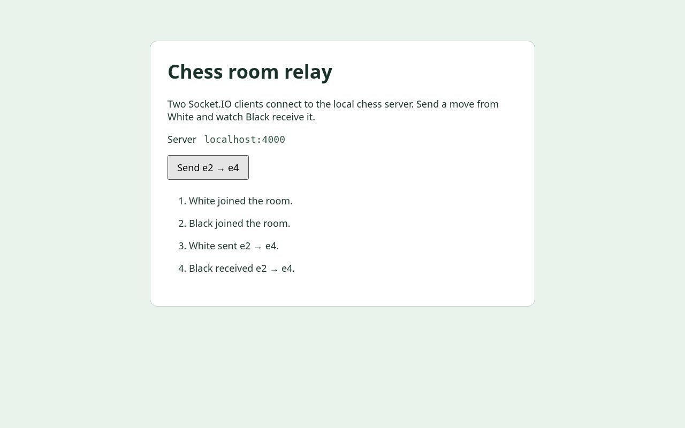
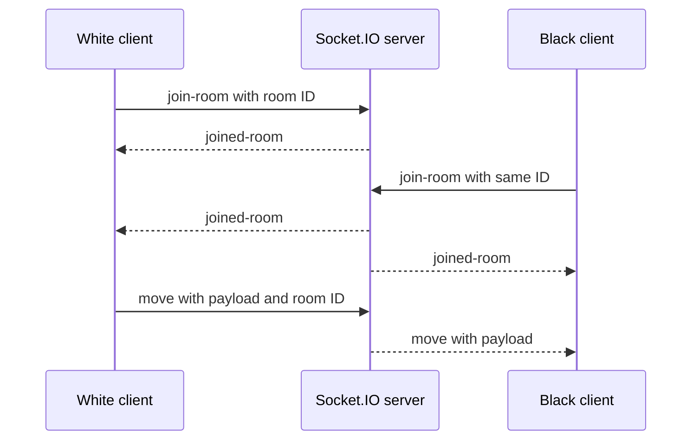

# Multiplayer Chess Server

A Node.js backend that relays chess moves between clients in the same Socket.IO room. Each game uses a room ID so clients can subscribe to one game's moves.

## Local preview



The documentation demo connected two independent clients to the running server. Black received the move sent by White.

## Problem and goal

Two chess clients need to see each other's moves without sending moves to unrelated games. The server uses one Socket.IO room per game and relays event payloads to peers. The client owns the board and its rules.

## Workflow



## Languages, tools and API

JavaScript runs on Node.js. Express and Node's HTTP server host Socket.IO, and CORS is configured for cross-origin clients. The application protocol is the event table below. Room tracking is held in process memory. The server accepts client-supplied room IDs and move payloads, so a public competitive game would also need identity, room authorization, move validation and a recoverable board state.

## Run on Windows with PowerShell

```powershell
git clone https://github.com/Ashishkumar401/multiplayer-chess-server.git
Set-Location .\multiplayer-chess-server
npm.cmd ci
npm.cmd start
```

Connect two Socket.IO clients to `http://localhost:4000`. On each client, emit `join-room` with the same room ID. Have one client emit `move` with a move payload followed by that room ID. The other client receives the payload.

| Client event | Server behavior |
| --- | --- |
| `join-room(roomId)` | Joins the socket to the room and broadcasts `joined-room` to its members |
| `move(payload, roomId)` | Forwards the payload to other sockets in the specified room |
| Disconnect | Logs the disconnected socket ID |

[Read the complete event handlers](server.js). Clients supply the board interface and move payload. Legal-move checks, turn enforcement and persistent game state are outside the current server implementation.

## See a move arrive in a second client

With the server running, open a second PowerShell window in the repository root. The included [room demo](docs/room-demo.html) uses the client script served by Socket.IO and opens two independent connections.

```powershell
py -3 -m http.server 4010 --bind 127.0.0.1 --directory .\docs
```

Open `http://localhost:4010/room-demo.html`, wait for both clients to join, then click **Send e2 → e4**. The final line appears when Black actually receives the server event. For a transport-level check from PowerShell, run `(Invoke-WebRequest 'http://localhost:4000/socket.io/?EIO=4&transport=polling').Content` and look for the Engine.IO handshake.

## Deployment status

The repository has no public homepage URL or GitHub deployment record. The screenshot above was captured on localhost. A separate hosted instance could not be verified.
